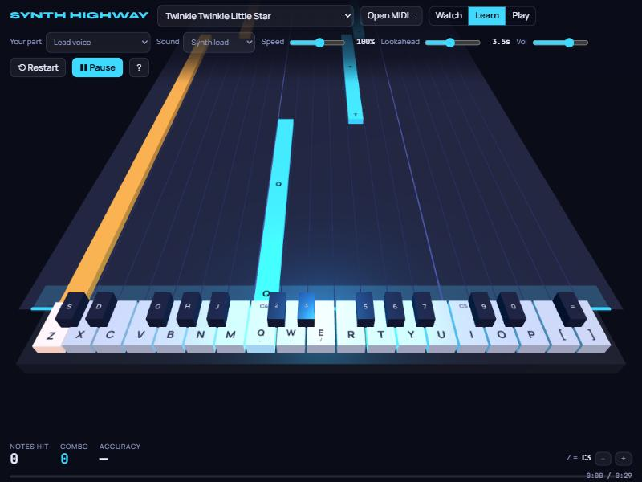

# Synth Highway

A Guitar Hero-style piano trainer you play on a normal computer keyboard, in the browser, with a Three.js note highway and a Web Audio synth. Drop in any MIDI file and learn it; the included pipeline turns your own songs (Suno tracks, demos, anything with a vocal) into playable MIDI with karaoke lyrics.

**Play it:** https://egrobar.github.io/synth-highway/

No install. One HTML file, Three.js from a CDN, sound from the Web Audio API.

> **The full game** lives in [`game/`](game/README.md): a Godot 4.7 night drive across five
> genre-themed regions, with scored holds, an audio-locked clock, Easy and Normal charts, and an
> in-game **Load your song** that turns your own MP3 or MIDI into a playable chart with stems. Its art,
> music and props are generated by the scripts in [`tools/`](tools/themes/README.md) (SuperCollider,
> Blender, GIMP).



## How to play

Notes ride the highway toward the keys. Press the letter printed on a note when it reaches the glowing line. Hold the key to hold the note.

Two rows, two and a half octaves. The **Q row** is the upper octave, the **Z row** the lower one. The sharps sit on the row physically above each white row, exactly like black keys sit behind white keys:

```
 2 3   5 6 7   9 0   =        C#4 D#4  F#4 G#4 A#4  C#5 D#5  F#5
Q W E R T Y U I O P [ ]       C4 D4 E4 F4 G4 A4 B4 C5 D5 E5 F5 G5

 S D   G H J   L ;            C#3 D#3  F#3 G#3 A#3  C#4 D#4
Z X C V B N M , . /           C3 D3 E3 F3 G3 A3 B3 C4 D4 E4
```

| Key | Action |
|---|---|
| Space | Play / pause |
| Backspace | Restart |
| Arrow up / down | Shift the whole keyboard an octave |
| Escape | Pause |
| Click the progress bar | Seek |

The on-screen keys also respond to mouse and touch.

### Modes

- **Watch** plays the song for you. Follow the notes and the lit keys.
- **Learn** freezes the song at every note until you press the right key. The key you need pulses. No clock pressure.
- **Play** runs at tempo and scores timing: Perfect, Good or Miss, with a combo.

### Your part

Blue notes are yours and carry the key to press. Orange notes are the other tracks, played automatically so the song sounds whole. Thin dark notes fall outside your keyboard window and play themselves.

The **Your part** menu picks what is yours: the lead voice (top note at each moment), all notes, right hand (C4 and up), left hand, or any named track in a MIDI file. The keyboard window shifts automatically so your part fits; a track named "vocal", "melody" or "lead" is selected on import.

Speed runs 40% to 150%. Lookahead sets how many seconds of highway you see.

### MIDI and lyrics

Drop a `.mid` file anywhere on the page or use **Open MIDI**. Format 0 and 1 files are supported, with tempo maps, track names and lyric events. If the file carries lyrics, they stream under the toolbar karaoke-style: the current line large, sung words lit, the word being sung in cyan, the next line below.

Ten public-domain pieces are built in, from Twinkle Twinkle to the Bach C major prelude and the Moonlight Sonata opening, with simple left-hand accompaniments.

## Make MIDI from your own songs

`pipeline/` turns a mixed song into a multi-track MIDI the trainer understands, with the vocal melody as its own track and optional word-timed lyrics.

```
audio ──► Demucs (stems) ──► Basic Pitch (notes per stem) ──► refine_melody (pyin check) ──► song.mid
                 │
                 └──► faster-whisper (word timestamps) ──► align_lyrics (your real lyrics) ──► song_full.mid
```

### Install

Python 3.10 or 3.11. CPU is fine: a three-minute song takes about two minutes to separate and seconds to transcribe.

```bash
python -m venv .venv
.venv/Scripts/python -m pip install torch==2.5.1 torchaudio==2.5.1 --index-url https://download.pytorch.org/whl/cpu
.venv/Scripts/python -m pip install -r pipeline/requirements.txt
```

`ffmpeg` on your PATH is needed to convert MP3 to WAV.

### Run

```bash
ffmpeg -i song.mp3 -ac 2 -ar 44100 song.wav
python pipeline/transcribe.py song.wav --out out/song.mid
python pipeline/refine_melody.py out/stems/htdemucs/song/vocals.wav out/song.mid out/song_refined.mid
```

`song_refined.mid` has three tracks: **Vocal melody**, **Synths / keys**, **Bass**. A `_melody.mid` companion with melody and bass only is written alongside; it is the easiest file for Learn mode.

Lyrics, in two steps. First let Whisper time the words it can hear:

```bash
python pipeline/lyrics_to_midi.py out/stems/htdemucs/song/vocals.wav out/song_refined.mid out/song_whisper.mid
```

Then put the **real** lyrics on that timeline. Save them to `lyrics.txt`, one line per lyric line; `[Verse]`-style section headers are fine and ignored:

```bash
python pipeline/align_lyrics.py lyrics.txt out/song_whisper.lyrics.json out/stems/htdemucs/song/vocals.wav out/song_refined.mid out/song_full.mid
```

The aligner fuzzy-matches your words to Whisper's timed words, forced-aligns the stretches Whisper skipped with torchaudio's MMS aligner, checks that against where the vocal energy actually is, and prints a per-line timetable so you can eyeball it. `inspect_midi.py` prints per-track stats of any MIDI.

### What to expect

Vocal transcription is good enough to learn a melody from and not a substitute for a human transcriber. Octave errors on sustained notes are the common failure; `refine_melody.py` fixes most. Heavily layered or vocoded choruses defeat both Whisper and the forced aligner, which is why the energy prior exists. Judge by ear in Watch mode, then tell the trainer which track is yours.

## How it works

- **Highway**: the keyboard is 32 keys from a C; notes are boxes whose length is their duration, moving at `highway length / lookahead` units per second, clipped at the hit line.
- **Timing**: the song clock advances per frame; Learn mode holds it at the next unplayed note of your part. Play mode windows are 70 ms for Perfect and 160 ms for Good, scaled by playback speed.
- **Synth**: four Web Audio patches (saw lead with filter envelope, FM-ish electric piano, additive organ, filtered pluck) through a compressor and a generated-impulse convolution reverb. Auto-played parts go through a quieter low-passed bus.
- **MIDI**: a small SMF parser handles running status, tempo maps, note on/off, track names and lyric/text meta events; syllables without a trailing space are joined, "/" or a newline starts a lyric line.

## Credits

[Three.js](https://threejs.org/), [Demucs](https://github.com/facebookresearch/demucs), [Basic Pitch](https://github.com/spotify/basic-pitch), [faster-whisper](https://github.com/SYSTRAN/faster-whisper), [torchaudio MMS_FA](https://pytorch.org/audio/stable/tutorials/forced_alignment_for_multilingual_data_tutorial.html), [librosa](https://librosa.org/), [pretty_midi](https://github.com/craffel/pretty-midi).

## License

MIT. See [LICENSE](LICENSE).
